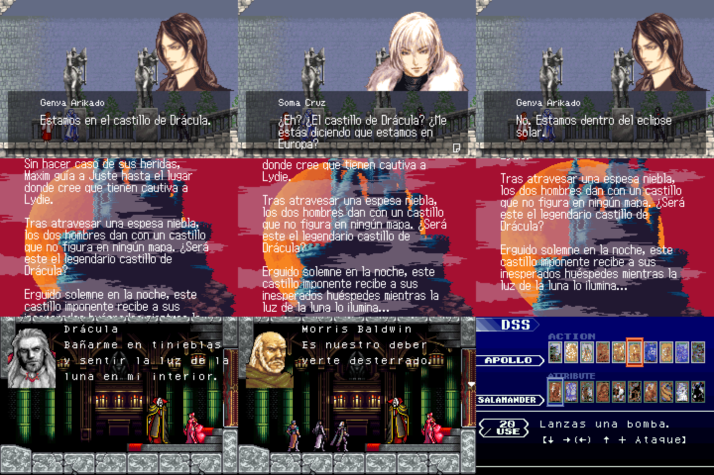

# Castlevania Advance Collection en español

Traducción al español de los tres juegos de Game Boy Advance de
**Castlevania Advance Collection** (versión de Steam), para sus versiones
**americana (US)** y **europea (EU)**:

| Juego | Qué está traducido |
|---|---|
| Castlevania: Circle of the Moon | Diálogos, menús, objetos, descripciones y DSS |
| Castlevania: Harmony of Dissonance | Diálogos, menús, objetos, enemigos y descripciones |
| Castlevania: Aria of Sorrow | Diálogos, menús, objetos, almas, enemigos y descripciones |



Las versiones japonesas no están traducidas. *Castlevania: Dracula X* (el de
Super Nintendo) tampoco: casi no tiene texto y el poco que tiene son imágenes.

El repositorio **no contiene ROMs ni archivos del juego**. Solo trae parches
(`.ips`) con las diferencias, y un instalador que los aplica sobre la copia del
juego que ya tienes comprada e instalada.

## Instalar

1. Instala [Python 3](https://www.python.org/downloads/) si no lo tienes
   (marca la casilla *Add python.exe to PATH*).
2. Descarga este repositorio (botón **Code → Download ZIP**) y descomprímelo
   donde quieras.
3. Cierra el juego y haz doble clic en **`Instalar.bat`**. Te pregunta dónde
   quieres el español:
   1. en la versión americana (US),
   2. en la versión europea (EU),
   3. en las dos.
4. Abre el juego y, en el menú de la colección, elige esa versión de cada
   juego. Las versiones que no elegiste siguen en su idioma original.

El instalador encuentra el juego solo (mira dónde está la carpeta y las
bibliotecas de Steam). Si no lo encuentra, te pide que arrastres la carpeta.
Para cambiar de opción basta volver a abrir `Instalar.bat`.

## Desinstalar

Doble clic en **`Desinstalar.bat`**. El juego queda byte a byte como estaba.

## Cosas que conviene saber

- **Si Steam actualiza el juego o verificas los archivos**, la traducción se
  pierde: vuelve a ejecutar `Instalar.bat`.
- **Las partidas guardadas no se tocan.** Los parches solo cambian textos y
  letras, no el formato de guardado, así que tus partidas de la versión
  americana o europea siguen sirviendo con o sin traducción.
- En **Aria of Sorrow europeo** el español sustituye al inglés (el francés y
  el alemán siguen ahí): si pusiste el juego en otro idioma, vuelve a
  *English*.
- Algunos rótulos son dibujos y no texto, así que siguen en inglés: la
  pantalla de título, los botones de los menús (*ITEM*, *EQUIP*, *SOUL SET*…),
  los nombres de las cartas DSS de Circle of the Moon y el menú de la propia
  colección.
- Las traducciones se probaron en un emulador con los ROMs ya parcheados.
  Si ves un texto cortado o raro dentro de la colección, abre una *issue* con
  una captura.

## Versión manual (arrastrar y soltar)

Si prefieres no depender de Python cada vez, puedes crear una carpeta para
poner y quitar la traducción arrastrando archivos:

```
python crear_manual.py
```

Crea la carpeta `Manual/` con un `LEEME.txt`, los datos (`Paso-1_Datos`) y una
carpeta por opción (`Paso-2_Americana`, `Paso-2_Europea`,
`Paso-2_Americana-y-europea`), más `Volver-al-original`.

**Esa carpeta contiene el juego completo (unos 370 MB): es para uso propio.
No la subas a GitHub ni la compartas.** Además solo vale para la versión del
juego con la que se creó; si el juego se actualiza, créala de nuevo.

## Cómo funciona

La colección guarda todos sus archivos en `windata/alldata.bin`, con un índice
en `windata/alldata.psb.m` (formato *MArchive* de M2). El instalador:

1. Saca de ahí el ROM de cada juego y versión elegidos.
2. Le aplica el parche de `parches/<juego>/<us|eu>/`.
3. Añade el ROM traducido **al final** de `alldata.bin` y apunta el índice a
   él. Los datos originales no se tocan, y el índice original se guarda como
   `alldata.psb.m.original`.

Por eso desinstalar es seguro: basta recortar `alldata.bin` a su tamaño
original y devolver el índice.

```
instalar.py        instalador (opciones: --us --eu --ambas --estado --desinstalar --extraer)
crear_manual.py    crea la versión de arrastrar y soltar a partir de tu juego
marchive.py        lector/escritor del formato MArchive, en Python puro
parches/           los parches .ips por juego y versión, y el catálogo parches.json
fuente/            los textos de la traducción y los programas que generan los parches
```

## Mejorar la traducción

Los textos están en archivos de texto normales dentro de `fuente/`, y son los
mismos para la versión americana y la europea:

- `nombres.txt` — glosario `inglés = español` (objetos, enemigos, lugares…)
- `textos.txt` — menús y descripciones
- `dialogos.txt` — las escenas

Para generar los parches después de cambiar algo:

```
python instalar.py --extraer
python fuente/aos/construir.py  roms/aos-us.gba  parches/aria-of-sorrow/us/aos-es.ips
python fuente/aos/construir.py  roms/aos-eu.gba  parches/aria-of-sorrow/eu/aos-es.ips
python fuente/hod/construir.py  roms/hod-us.gba  parches/harmony-of-dissonance/us/hod-es.ips
python fuente/hod/construir.py  roms/hod-eu.gba  parches/harmony-of-dissonance/eu/hod-es.ips
python fuente/cotm/construir.py roms/cotm-us.gba parches/circle-of-the-moon/us/cotm-es.ips
python fuente/cotm/construir.py roms/cotm-eu.gba parches/circle-of-the-moon/eu/cotm-es.ips
```

Cada `construir.py` reconoce la versión del ROM, ajusta el texto al ancho de
cada cuadro y avisa si algo no cabe. Añade a la fuente del juego las letras que
le faltan (á é í ó ú ñ ü ¿ ¡). La carpeta `roms/` está en `.gitignore`:
**no subas ROMs**.

## Créditos

- Traducción y herramientas: este repositorio.
- Las direcciones de algunas tablas de Aria of Sorrow y Harmony of Dissonance
  se contrastaron con las del editor [DSVEdit](https://github.com/LagoLunatic/DSVEdit)
  de LagoLunatic.
- Pruebas hechas con el emulador [mGBA](https://mgba.io/).

Castlevania es una marca de Konami Digital Entertainment. Proyecto de
aficionados, sin relación con Konami. Necesitas tener el juego original.
